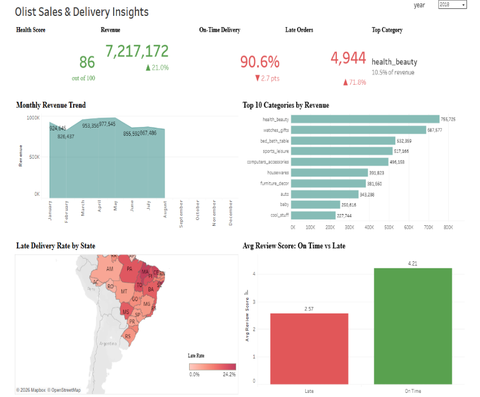

# Olist Sales & Delivery Insights Dashboard

An interactive Tableau dashboard built on 99K+ Brazilian e-commerce orders, with the full SQL analysis behind it.

**Live dashboard:** [PASTE-YOUR-NEW-TABLEAU-LINK-HERE](https://public.tableau.com/app/profile/yennapusala.bhanu.kiran.reddy/viz/OlistSalesandDeliveryInsights_17916085741520/OlistSalesDeliveryInsights?publish=yes)

## Problem
Find where revenue comes from, where delivery performance breaks down, and how late deliveries affect customer reviews and repeat purchases.

## Data
Brazilian E-Commerce Public Dataset by Olist (Kaggle): 9 tables, 100K+ orders, Sep 2016 to Aug 2018, loaded into PostgreSQL.
All money values are in Brazilian Reais (R$). 2018 covers Jan to Aug only.

## Key Findings
1. Monthly revenue grew from R$ 112K (Jan 2017) to a peak of R$ 988K (Nov 2017), the Black Friday spike.
2. 8.11% of delivered orders arrive late.
3. Late deliveries drop the average review score by about 40% (4.29 on time vs 2.57 late).
4. Only 3.12% of customers place a second order.
5. Northeast states (AL, MA, PI, CE) have 2-3x the national late rate. AL is the worst at 23.93%.
6. Orders shipped across states take about 2x longer (14.6 vs 7.5 days) and are about 50% more likely to be late.
7. health_beauty is the top revenue category. Credit cards are 74% of payments.

## Recommendation
Onboard regional sellers or fulfilment centres in Northeast Brazil to cut delivery time and protect review scores, which are linked to repeat purchases.

## Dashboard Features
- **Year filter** (2017 / 2018) that drives every chart and KPI card
- **Overall Health Score (0-100):** 50% on-time delivery rate + 50% average review score (out of 5)
- **KPI cards:** Revenue vs previous year, On-Time Delivery % vs previous year, Late Orders, Top Category with revenue share
- **Charts:** monthly revenue trend, top 10 categories, late delivery rate by Brazilian state (map), review score on-time vs late
- **Interactive map:** click a state and the whole dashboard filters to that state
- **Colour logic:** green = good, red = bad. For Late Orders the logic is reversed (more late orders is red)

## Files
| File | What it is |
|------|------------|
| `queries.sql` | All SQL: revenue, growth, late rate, reviews, repeat customers, categories, sellers, payments, state analysis, and the master view for Tableau |
| `dashboard-data/orders_master.csv` | Order-level data exported from the master view |
| `dashboard_screenshot.png` | Dashboard preview |

## Tools
PostgreSQL, SQL (CTEs, window functions, views), Tableau Public (parameters, calculated fields, LOD expressions, filled maps, dashboard actions)
